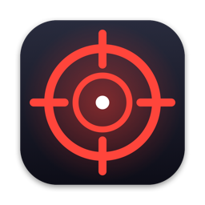

<p align="center"></p>

# СДВГ Киллер · ADHD Killer

**Русский** · [English](#english)

Маленькая программа для строки меню Mac, которая не даёт залипнуть.
Ты пишешь, чем занимаешься. Она поглядывает, какое окно открыто, и если ты
ушёл в YouTube, ленту или переписку не по делу — края экрана начинают
краснеть, а в углу появляется короткая реплика:

> Мудборд сам себя не соберёт. Голы подождут.

Через минуту не по делу — мягкое предупреждение со звуком, через две — жёсткое.
Вернулся к задаче — всё гаснет.

## Установка

👉 **[Пошаговая инструкция для тех, кто не дружит с Терминалом](INSTALL.md)**

Коротко: открой **Терминал** и вставь одну строку:

```bash
curl -fsSL https://raw.githubusercontent.com/ValikW/adhd-killer/main/install.sh | bash
```

Программа появится в «Программах» и в строке меню (значок ◎).
Xcode и другие инструменты не нужны. Работает на macOS 13 и новее,
на Маках с Apple Silicon и Intel.

## Первый запуск

1. **Ключ Anthropic API.** Создай на [console.anthropic.com](https://console.anthropic.com/settings/keys)
   и вставь, когда программа попросит. Проверки платные, платишь ты сам:
   обычно это несколько центов за рабочий день (модель Claude Haiku).
2. **Доступ к окнам.** macOS спросит разрешение «Универсальный доступ» —
   включи «СДВГ Киллер» в Системных настройках → Конфиденциальность и
   безопасность → Универсальный доступ. Без этого программа не видит названия окон.
3. **Задача.** Напиши одну задачу: «написать пост про запуск», «смонтировать рилс».

## Меню

- **Сменить задачу / Задача сделана** — одна текущая задача.
- **Это работа** — если программа ошиблась, это окно до конца дня считается работой.
- **Перерыв 15 минут** — молчит четверть часа.
- **Слежка включена** — выключить совсем.
- **Звук** — свой звук для мягкого и жёсткого предупреждения или без звука.
- **Сегодня: N проверок · $** — сколько потрачено.
- **Запускать при входе** — стартовать вместе с Маком.
- **Дополнительные настройки** — рабочие часы, минуты до предупреждения, модель.

## Что уходит в интернет

Честно: раз в 20+ секунд, когда окно сменилось, в Anthropic отправляются
**название программы, заголовок окна и адрес сайта** (без параметров после `?`)
и текст твоей задачи. Скриншоты не делаются, содержимое окон не читается.
Менеджеры паролей пропускаются. Ключ и настройки лежат только у тебя:
`~/Library/Application Support/ADHDKiller/settings.json`.

Не включай программу, если на экране бывает то, что нельзя показывать третьей стороне.

## Удаление

```bash
curl -fsSL https://raw.githubusercontent.com/ValikW/adhd-killer/main/uninstall.sh | bash
```

## Сборка из исходников

```bash
git clone https://github.com/ValikW/adhd-killer && cd adhd-killer
./tests/run.sh
./build.sh --install
```

Нужны Command Line Tools (`xcode-select --install`), полный Xcode не нужен.

После обновления macOS может снова спросить «Универсальный доступ»: у программы
нет платной подписи Apple, и система видит новую версию как новое приложение.

---

## English

A tiny macOS menu bar app that keeps you from drifting off.
You type what you are working on. It glances at the active window, and when you
slip into YouTube, a feed or an unrelated chat, the screen edges glow red and a
short line appears in the corner. One minute off task — a soft warning with a sound, two —
a hard one. Back on task — it fades.

### Install

```bash
curl -fsSL https://raw.githubusercontent.com/ValikW/adhd-killer/main/install.sh | bash
```

macOS 13+, Apple Silicon and Intel. No Xcode needed.

### First run

1. **Anthropic API key** from [console.anthropic.com](https://console.anthropic.com/settings/keys).
   You pay for checks yourself, usually a few cents per working day (Claude Haiku).
2. **Accessibility access** in System Settings → Privacy & Security → Accessibility,
   so the app can read window titles.
3. **One task**, e.g. "write the launch post".

### What leaves your Mac

The app name, window title, site address (without the query string) and your task
text are sent to Anthropic when the window changes. No screenshots, no window
contents. Password managers are skipped. The key and settings stay in
`~/Library/Application Support/ADHDKiller/settings.json`.

### Build from source

```bash
git clone https://github.com/ValikW/adhd-killer && cd adhd-killer
./tests/run.sh && ./build.sh --install
```

### License

MIT
